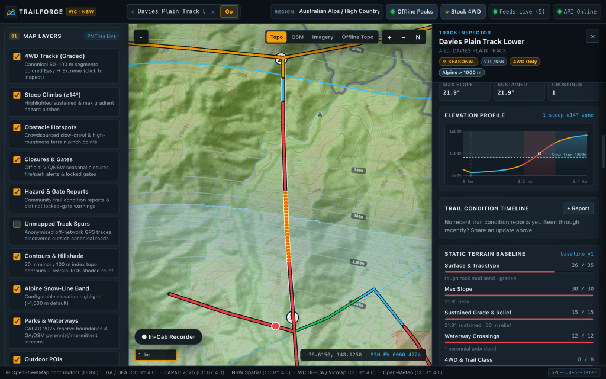

<div align="center">

# TrailForge

**Open-source, self-hostable 4WD & off-road mapping, live track-grading, multi-track route planning, and trail-intelligence platform across all 8 Australian states & territories (`VIC`, `NSW`, `ACT`, `TAS`, `QLD`, `WA`, `SA`, `NT`).**

[](LICENSE)
[](CHANGELOG.md)
[](pyproject.toml)
[](Dockerfile)
[](web/package.json)
[](docker-compose.ghcr.yml)
[](tests/)
[](docker-compose.yml)
[](https://github.com/jremick/gridforge)

Pan-Australia 8-State Open Data · Explainable 2-Stage Grading · Interactive Route Planner · Pluggable HMM / Valhalla Sidecar + 50 Hz IMU Telemetry · 11 Live AU Closure Feeds · 15-Region Streaming Offline Packs · Capacitor 7 Mobile Shell & 4WD Clinometer · GridForge 300 DPI Strip Atlas Handoff

</div>

---



## What Makes TrailForge Different

| Capability | TrailForge | Proprietary 4WD Apps (Newtracs / OnX) |
| :--- | :--- | :--- |
| **Transparent Two-Stage Grading** | Combines a deterministic **Day-1 DEM/OSM baseline** (`surface`, `tracktype`, max/sustained slope degrees, waterway crossings, `4wd_only`) with recency-weighted, vehicle-class-normalized telemetry (`AWD`–`Modified 4WD`) and **72-hour rainfall** context — exposing exact factor breakdowns, sample counts, freshness, and obstacle hotspots. | Opaque black-box difficulty scores with no visibility into terrain vs. traffic weighting, vehicle capability bias, or wet-weather risk shifts. |
| **Interactive Multi-Track Route Planner** | Chain multiple 4WD tracks into a single stitched route with **2-state DP automatic leg orientation**, `> 100 m` gap detection, combined 4-grade elevation profile, worst-grade & rig suitability summary, closure/gate/wet-risk alerts, saved trip plans, and one-click **GridForge 300 DPI Strip Atlas** CLI handoff. | Disconnected track pages or cloud-locked route builders with no combined closure/suitability rollup or topo print handoff. |
| **Privacy-by-Design Telemetry, 50 Hz IMU & Valhalla Sidecar** | Enforces mandatory **`≥ 250 m` start/end buffer trimming** on both GPS breadcrumbs and **high-rate 10–100 Hz mobile IMU** samples (`roughness_rms`, `roughness_p95`, shock count, pitch/roll peaks), stores **zero `user_id` or `trip_id`** on public segment observations, supports instant **private ↔ anonymous community** HMAC revocation, and swaps cleanly between the default in-PostGIS HMM matcher and an optional **Valhalla `/trace_attributes` sidecar** (`deploy/valhalla-compose.override.yml`) with automatic HMM fallback. | Mandatory cloud accounts with opaque location-history retention, limited control over contributed GPS traces, and no pluggable self-hosted map-matching backend. |
| **Pan-Australia Closures & CAPAD Park Alerts (11 Feeds)** | Pluggable ingesters across **all 8 Australian states & territories** — **VIC MapShareVic**, **VicEmergency**, **NSW RFS**, **NSW NPWS**, **ACT ESA**, **TasALERT / PWS**, **QLD DES (QPWS) / QFES**, **Emergency WA (DFES/DBCA)**, **SA CFS / NPWS SA**, **SecureNT / Bushfires NT**, and OSM `barrier=gate` / `access=private` flags — with CAPAD 2025 joins, lean opt-in `TRAILFORGE_ENABLED_STATES` polling, `?state=` filtering, and cached **outage staleness badges**. | Manually curated or delayed closures disconnected from live Australian emergency and national park feeds. |
| **Pan-Australia 8-State Bake & 15-Region Offline Packs** | Streaming **`< 300 MB` RAM** OSM PBF (`osmium`) + **`AutoAUStateTrailsRouter`** across all 8 states (with dynamic per-state attributions and strict WA `CC BY-NC` exclusion) powering **15 regional & statewide offline packs** (`7` iconic 4WD regions + `8` statewide) with SHA-256 manifests and Service Worker **HTTP `206` range-sliced** `PMTiles`. | Paywalled offline downloads locked inside proprietary mobile silos with no self-hosted control. |
| **Capacitor 7 Mobile Shell & Live 4WD Clinometer** | Zero-crash native/PWA runtime bridge (`web/src/native/bridge.ts`), `web/capacitor.config.ts`, iOS/Android locked-screen background GPS & high-rate sensor templates (`mobile/`), live **Pitch° / Roll° 4WD Clinometer** (`≥ 15°` caution amber / `≥ 25°` hazard red) + shock counter in the In-Cab Recorder, `POST /api/trips/mobile-sync`, one-tap **Backtrack**, and CarPlay / Android Auto projection spec. | Closed mobile apps with no self-hosted sync, no open CarPlay/Android Auto path, and opaque sensor retention. |
| **Zero-Build Self-Hosting & Production HTTPS Kit** | Multi-arch (`arm64` + `amd64`) prebuilt GHCR Compose (`docker-compose.ghcr.yml`) + turnkey **Tailscale Serve**, **Caddy v2**, **Traefik v3**, and optional **Valhalla sidecar** overrides (`deploy/`) with Range-safe `206` streaming, **zero Redis/Kafka**, and **zero PyQGIS**. | Cloud-only SaaS — cannot be self-hosted for 4WD clubs, SAR teams, or private homelabs. |
| **100% Open & ODbL-Clean Licensing** | `GPL-3.0-or-later` source code with strict **3-tier OSM ODbL table separation** isolating OpenStreetMap base geometries/tags and Tier A state source tables (`source_tracks_vic`, `source_tracks_nsw`, `source_tracks_au_state`) from crowdsourced telemetry, live grades, closures, condition reports, and saved `planned_routes`. | Closed-source subscriptions and proprietary map/data lock-in. |

---

## Visual Feature Gallery

| **Interactive Multi-Track Route Planner & GridForge Handoff** | **Rig Suitability, Closures & Gate Warnings** |
| :---: | :---: |
|  |  |
| *Stitched multi-track routes (`S → 2 → F`), combined 4-grade elevation SVG, closure/rig risk summary & 1-click GridForge 300 DPI CLI handoff* | *Rig Suitability (`AWD`–`Modified 4WD`), Official VIC/NSW Closures & Community Gate Warnings with One-Click OSM Fixes* |

| **Streaming Offline Packs (VIC & NSW)** | **In-Cab PWA Recorder & Backtrack** |
| :---: | :---: |
|  |  |
| *Streaming VIC & NSW Offline Regional Packs (`australian-alps`, `blue-mountains`, `vic`, `nsw`) with SHA-256 Verification* | *In-Cab PWA Breadcrumb Recorder with One-Tap Backtrack, Screen Wake Lock & Offline GPX/GeoJSON Export* |

---

## 60-Second Self-Hosted Quickstart

### Option A: Zero-Build Production / Homelab Deploy (Prebuilt Multi-Arch GHCR)

Pull prebuilt `linux/arm64` + `linux/amd64` images directly from GitHub Container Registry — **no local Docker builds required**:

```bash
git clone https://github.com/jremick/trailforge.git
cd trailforge
cp .env.example .env
# Edit .env: set strong POSTGRES_PASSWORD, DATABASE_URL, AUTH_SECRET_KEY &
# TRAILFORGE_PRIVACY_SECRET (`openssl rand -hex 32`), CORS_ORIGINS, and AUTH_COOKIE_SECURE=true
docker compose -f docker-compose.ghcr.yml up -d
curl -fsS http://127.0.0.1:5173/api/health
```

`docker-compose.ghcr.yml` binds safely to `127.0.0.1:5173` by default for HTTPS reverse-proxy deployments (required on phones/tablets for PWA Service Worker offline packs, Geolocation API, Screen Wake Lock, and `AUTH_COOKIE_SECURE=true`). See the turnkey **[Production HTTPS Deploy Kit (`deploy/README.md`)](deploy/README.md)** for:
- **[Tailscale Serve (`deploy/tailscale-serve.md`)](deploy/tailscale-serve.md)** — zero-port-forward private Tailnet HTTPS for phones and in-cab tablets
- **[Caddy v2 (`deploy/Caddyfile.example`)](deploy/Caddyfile.example)** — automatic Let's Encrypt HTTPS with 15 MB upload cap and Range/HTTP `206` PMTiles passthrough
- **[Traefik v3 (`deploy/traefik-compose.override.yml`)](deploy/traefik-compose.override.yml)** — drop-in Compose override with Range-safe headers and upload limits
- **[Optional Valhalla Sidecar (`deploy/valhalla.md`)](deploy/valhalla.md)** — opt-in Valhalla `/trace_attributes` Compose override (`deploy/valhalla-compose.override.yml`) with automatic fallback to `PostGISHMMMatcher`
- **Backup & Upgrade Runbook** — PostGIS `pg_dump`, `/data/uploads` & `/data/packs` archives, and low-downtime image tag upgrades

### Option B: Local Build & Demo Corridor Quickstart (`docker compose up`)

Build locally on Apple Silicon (`arm64`) or Linux (`amd64`) and seed the offline Australian Alps demo corridor:

```bash
git clone https://github.com/jremick/trailforge.git
cd trailforge
cp .env.example .env
docker compose up -d --build --wait
make seed-corridor
```

Open **<http://localhost:5173>** in your browser (interactive OpenAPI docs at **<http://localhost:8000/docs>**, health check at `/api/health`).

### What `make seed-corridor` Loads (Australian Alps High Country Demo)

`make seed-corridor` runs the full 6-stage offline pipeline (`ingestion` → `feeds` → `seed_demo` → `grading` → `tiles` → `packs`) on the **VIC/NSW Davies Plain / Tom Groggin border corridor** (MGRS `55H FV`, `600–1,634 m` AHD):

- **Conflated Multi-Source Tracks:** `Davies Plain Track Lower`, `Davies Plain Ridge`, `Bucky Ridge Fire Trail`, and `Pinch River Fire Trail` (plus `Tom Groggin Access Rd`, `Poplars Fire Trail`, `Station Creek Private Spur`, and `Limestone Creek Bridged Link`) conflated across OSM, VIC Vicmap/RecWeb, and NSW Spatial Services into deterministic 50–100 m segments.
- **Terrain, Waterways & Snow-Line:** DEM-draped elevation profiles, steep-section highlights, unbridged **Murray River ford** crossing attribution, 20 m contours, Terrain-RGB hillshade, and an interactive **alpine snow-line slider** (`800–1,600 m`, default `1,000 m`).
- **Live VIC & NSW Closures & Gates:** MapShareVic winter seasonal closure on Davies Plain, VicEmergency fuel-reduction burn Watch & Act on Bucky Ridge, NSW NPWS Kosciuszko wet-conditions advisory joined to CAPAD boundaries, and an OSM locked gate on Station Creek Private Spur.
- **Live Telemetry, Rainfall & Hotspots:** Anonymized multi-rig passes (`Stock 4WD` / `Touring 4WD` / `Modified 4WD`), `18.5 mm` 72-hour rainfall wet-condition context, and 22 slow/rough escarpment obstacle hotspots.
- **Ready-to-Download Offline Pack:** Pre-built `australian-alps` offline pack (`vector.pmtiles`, `terrain.pmtiles`, `snapshot.json`, SHA-256 `manifest.json`, and `bundle.tar.gz`) ready to cache in-browser for zero-signal navigation.

> **Anonymous-first:** Browse maps, inspect tracks, plan multi-track routes, search VIC/NSW tracks/POIs/`lat,lon`/MGRS, switch Quick Rig classes (`AWD`–`Modified 4WD`), and export GPX/GeoJSON with zero sign-in. Register locally inside the **Rig & Account** drawer to save custom Vehicle Profiles, saved routes, favorites, personal pins, GPX/telemetry uploads, and timestamped hazard/gate reports. Stop the stack cleanly anytime with `make down`.

---

## Interactive Multi-Track Route Planner & GridForge Handoff

Plan multi-track 4WD trips directly in the map UI (**`Route`** pill in the top bar or **`+ Route`** in the Track Inspector) or via `/api/routes`:

- **Click-to-Chain Planning & Automatic Leg Orientation:** Click tracks on the map to append/reorder legs; a 2-state dynamic-programming optimizer automatically reverses legs when needed to minimize endpoint jumps and flags any `> 100 m` road-link gaps.
- **Unified Trip Intelligence:** Aggregates total distance, estimated travel time (using live telemetry speed or grade heuristics), elevation gain/loss, combined 4-grade SVG elevation profile, worst difficulty & active rig suitability verdict, intersecting official VIC/NSW closures, community locked-gate warnings, wet-weather risk, unbridged waterway crossings, and nearby huts/campsites.
- **Offline-Capable Planning & Saved Trips:** Works offline from downloaded regional pack snapshots, and authenticated users can save/update/reload personal route plans in Tier C `planned_routes` (strictly ODbL-separated — stores only canonical `track_ids` and user waypoints, zero OSM geometries/tags).
- **One-Click GridForge 300 DPI Strip Atlas Handoff:** Export stitched **GPX 1.1** (complete with `<trk>` trackpoints plus `<wpt>` pins for crossings, camps/huts, and custom waypoints) or **RFC 7946 GeoJSON**, and copy the pre-filled `gridforge render --strip-route ...` CLI command directly from the Route Planner drawer to print a true-scale 1:25,000 UTM/MGRS waterproof backup strip atlas in sibling project [GridForge](https://github.com/jremick/gridforge):

```bash
# Export a planned multi-track route (or click "⬇ GPX 1.1" + "Copy CLI" in the Route Planner drawer)
mkdir -p out
curl -fsSL -X POST "http://localhost:5173/api/routes/plan/export?format=gpx" \
  -H "Content-Type: application/json" \
  -d '{"name":"Davies Plain Loop","track_ids":["<track_id_1>","<track_id_2>"]}' \
  -o out/davies_plain_loop.gpx

# Render a 300 DPI true-scale UTM strip atlas + elevation profile + 100 mm calibration sheet in GridForge
docker run --rm -v "$(pwd)/out:/out" ghcr.io/jremick/gridforge:latest \
  gridforge render --strip-route /out/davies_plain_loop.gpx --scale 25000 --paper a4 \
    --dem-source au-elvis --au-overlay au-state-trails --slope-shading \
    --elevation-profile --calibration-page \
    --title "DAVIES PLAIN LOOP — VIC/NSW BACKUP STRIP ATLAS" \
    --output /out/davies_plain_loop_strip_atlas.pdf
```

---

## Real-Data Regional Bake CLI & Demo Cookbook

### Streaming Real-Data Regional & Statewide Bake (`bake_cli`)

Bake real Australian open-data networks (streaming Geofabrik `.osm.pbf` via `osmium` or Overpass + VIC DataVic WFS + NSW Spatial ArcGIS + GA Surface Hydrology + CAPAD 2025 + GA 5 m LiDAR / DEA SRTM 1s COG DEM) in memory-bounded `0.25°` spatial tiles with atomic resumable manifests (`< 300 MB` RAM):

```bash
# Convenience targets for Australian Alps & Blue Mountains (optional local PBF or bbox override)
make bake-alps BAKE_ARGS="--bbox 148.08,-36.56,148.15,-36.50"
make bake-blue-mountains BAKE_ARGS="--pbf /data/cache/australia-latest.osm.pbf"

# Full CLI with tiled resumable manifest, live closures, rainfall, PMTiles & offline pack build
docker compose exec -T api python -W error::RuntimeWarning -m trailforge.ingestion.bake_cli \
  --region vic \
  --pbf /data/cache/australia-latest.osm.pbf \
  --cache-dir /data/cache \
  --build-tiles --build-pack

# Offline dry-run & 10,000+ segment PostGIS GIST scale benchmark
docker compose exec -T api python -W error::RuntimeWarning -m trailforge.ingestion.bake_cli --fixtures tests/fixtures --dry-run
docker compose exec -T api python -W error::RuntimeWarning -m trailforge.ingestion.benchmark
```

### One-Command API & GPX Walkthrough

Explore the complete v1 API flow against your running stack using [`examples/demo-walkthrough.sh`](examples/demo-walkthrough.sh), [`examples/davies_plain_drive.gpx`](examples/davies_plain_drive.gpx), and [`examples/telemetry_sample.json`](examples/telemetry_sample.json) (see [`examples/README.md`](examples/README.md) for details):

```bash
./examples/demo-walkthrough.sh
```

### Individual Stage CLI Commands

Every stage is also scriptable headlessly inside the `api` container (zero external brokers):

```bash
# 1. Ingest & conflate OSM + VIC + NSW tracks into deterministic 50–100 m segments + Day-1 DEM grading
docker compose exec -T api python -m trailforge.ingestion.pipeline --fixtures tests/fixtures

# 2. Sync official closures, emergency feeds, CAPAD park alerts & OSM gates (--fixtures, --live, --states ALL)
docker compose exec -T api python -m trailforge.feeds.cli --fixtures tests/fixtures/closures_sample.json
docker compose exec -T api python -m trailforge.feeds.cli --live --states VIC,NSW,ACT
docker compose exec -T api python -m trailforge.feeds.cli --live --states ALL

# 3. Recompute explainable crowdsourced live grades, hotspots & 72h rainfall (--offline-rain-72h or --live-rainfall)
docker compose exec -T api python -m trailforge.grading.cli --offline-rain-72h 18.5
docker compose exec -T api python -m trailforge.grading.cli --live-rainfall

# 4. Build vector & Terrain-RGB PMTiles (graded tracks, steep highlights, contours, snow-line bands, POIs)
docker compose exec -T api python -m trailforge.tiles.cli \
  --output-dir /data/tiles \
  --dem tests/fixtures/dem_alps_corridor.tif

# 5. Build streaming regional offline packs (any of the 15 Pan-Australia regions; < 300 MB RAM)
docker compose exec -T api python -m trailforge.packs.cli \
  --region australian-alps \
  --output-dir /data/packs \
  --dem tests/fixtures/dem_alps_corridor.tif
```

### Pan-Australia 15-Region Offline Pack Catalog

`GET /api/packs` exposes **15 curated offline pack regions** (`7` Iconic 4WD Regions + `8` Statewide/Territory-wide packs) with dynamic per-state agency attributions:

| Region ID | Scope | Category | States | WGS84 BBox (`w, s, e, n`) |
| :--- | :--- | :--- | :--- | :--- |
| **`australian-alps`** | Victorian High Country, Davies Plain, Tom Groggin, Alpine NP & Kosciuszko NP | Iconic 4WD | `VIC, NSW` | `146.5, -37.6, 149.2, -35.4` |
| **`blue-mountains`** | Newnes Plateau, Wollemi, Kanangra-Boyd, Abercrombie & Blue Mountains | Iconic 4WD | `NSW` | `149.7, -34.2, 150.9, -32.9` |
| **`tasmania-wilderness`** | Tarkine, Climies Track, Sandy Cape, Cradle Mountain & Central Highlands | Iconic 4WD | `TAS` | `145.0, -42.6, 146.8, -41.1` |
| **`far-north-qld`** | Old Telegraph Track, CREB Track, Bloomfield Track & Cape York Peninsula | Iconic 4WD | `QLD` | `142.0, -17.6, 146.2, -10.6` |
| **`flinders-ranges`** | Ikara-Flinders Ranges, Brachina Gorge, Moralana & Gammon Ranges | Iconic 4WD | `SA` | `138.0, -32.6, 139.6, -30.2` |
| **`red-centre`** | West MacDonnell Ranges, Finke Gorge, Palm Valley & Mereenie Loop | Iconic 4WD | `NT, SA` | `130.4, -26.5, 134.5, -23.4` |
| **`perth-hills`** | Mundaring Powerlines Track, Dwellingup, Collie & WA Southwest forests | Iconic 4WD | `WA` | `115.0, -34.5, 116.8, -31.5` |
| **`vic`** | Statewide Victoria (Mallee, Grampians, Otways, High Country, East Gippsland) | Statewide | `VIC` | `140.9, -39.2, 150.1, -33.9` |
| **`nsw`** | Statewide NSW & ACT (Snowy Mountains, Blue Mountains, Barrington Tops, Outback) | Statewide | `NSW, ACT` | `140.9, -37.6, 153.7, -28.1` |
| **`act`** | Australian Capital Territory (Namadgi NP, Tidbinbilla & Brindabella Range) | Statewide | `ACT` | `148.74, -35.94, 149.42, -35.10` |
| **`tas`** | Statewide Tasmania (West Coast, Tarkine, Central Highlands & Northeast) | Statewide | `TAS` | `143.80, -43.75, 148.55, -39.55` |
| **`qld`** | Statewide Queensland (Southeast QLD, K'gari, Cape York & Channel Country) | Statewide | `QLD` | `137.95, -29.20, 153.60, -10.00` |
| **`wa`** | Statewide Western Australia (Southwest, Pilbara, Kimberley, Gibb River, CSR) | Statewide | `WA` | `112.85, -35.20, 129.05, -13.65` |
| **`sa`** | Statewide South Australia (Flinders, Gawler Ranges, Eyre Peninsula & Border Track) | Statewide | `SA` | `128.98, -38.10, 141.05, -25.95` |
| **`nt`** | Northern Territory (Top End, Kakadu, Litchfield, Arnhem Land & Red Centre) | Statewide | `NT` | `128.98, -26.05, 138.05, -10.90` |

---

## Optional Valhalla Sidecar, 50 Hz Mobile IMU & Capacitor Shell

- **Pluggable Valhalla Map-Matching Sidecar (`deploy/valhalla.md`):** TrailForge stays lean on `PostGISHMMMatcher` (`TRAILFORGE_MATCHER_BACKEND=postgis_hmm`) by default. On servers with spare RAM, layer [`deploy/valhalla-compose.override.yml`](deploy/valhalla-compose.override.yml) to enable Valhalla `/trace_attributes` (`use_tracks=1.0`, Polyline6 decode, canonical PostGIS `track_segments` projection preserving strict ODbL separation) with automatic `postgis_hmm_fallback` on timeout or HTTP error:
  ```bash
  docker compose -f docker-compose.yml -f deploy/valhalla-compose.override.yml up -d
  ```
- **High-Rate Mobile IMU & Background Sync (`POST /api/trips/mobile-sync`):** Accepts mobile/Capacitor background GPS + 10–100 Hz accelerometer/clinometer batches (`ImuSample`), strips gravity baseline, computes `roughness_rms`, `roughness_p95`, debounced `shock_event_count` (`> 0.8g` dynamic / `> 1.8g` total), and `max_pitch_deg` / `max_roll_deg`, and **strictly discards all IMU samples inside the mandatory `≥ 250 m` start/end privacy buffer** before any public segment metrics are persisted.
- **Capacitor 7 iOS/Android Shell & CarPlay/Android Auto Spec (`mobile/`):** Wrap the offline PWA in a native iOS/Android container (`web/capacitor.config.ts`, `web/src/native/bridge.ts`) for locked-screen background GPS and 50 Hz IMU capture, featuring a live **4WD Clinometer** (`Pitch° / Roll°` with amber `≥ 15°` / red `≥ 25°` alerts) in the In-Cab Recorder. See [`mobile/README.md`](mobile/README.md) for Xcode/Android Studio setup and [`mobile/carplay-android-auto.md`](mobile/carplay-android-auto.md) for `CPMapTemplate` & `NavigationTemplate` in-dash projection architecture.

---

## Measured Performance, Accuracy & Memory Profile

Measured on an Apple Silicon **16 GB RAM** host running native `linux/arm64` Docker Compose (`imresamu/postgis:16-3.4`, Python `3.12`, GDAL, `osmium-tool`, Tippecanoe `2.79.0`, `go-pmtiles 1.31.2`, Nginx + MapLibre GL JS `5`):

| Metric | Measured Result | Guardrail / Target |
| :--- | :--- | :--- |
| **Combined stack idle RAM (`docker stats`, 4 healthy containers)** | **`~350 MiB`** total (`db` `168.1 MiB` · `api` `95.8 MiB` · `worker` `78.5 MiB` · `web` `7.3 MiB`) | 16 GB laptop / homelab friendly (`512m`/`512m`/`512m`/`128m` caps, zero Redis/Kafka) |
| **10,000+ segment scale benchmark (`benchmark.py`)** | **`11,179` canonical segments** (`150` tracks) in **`13.65 MiB`** peak Python heap (`138.49 MiB` RSS) | `< 300 MB` streaming RAM budget |
| **PostGIS `EXPLAIN ANALYZE` over `11,179` segments** | **`0.18–0.63 ms`** GIST index scans (`bbox` `0.291 ms` · HMM `ST_DWithin` `0.184 ms` · closure join `0.635 ms`; **`0` Seq Scans** on `track_segments`) | Indexed `ix_track_segments_geom_active` GIST lookups |
| **Offline pack builder peak Python heap** | **`51.79 MB`** (`australian-alps` PMTiles + snapshot + `bundle.tar.gz`) | `< 300 MB` streaming RAM budget |
| **Canonical segment-ID preservation (`v2` jittered re-import)** | **`100%`** (`358 exact + 86 spatial` = `444 / 444` preserved; `0` orphaned) | Deterministic identity across OSM/state updates |
| **Pluggable map-matching (HMM default + Valhalla sidecar)** | **`0.9739`** mean HMM confidence across **`145`** Davies Plain segments; Valhalla `/trace_attributes` + automatic `postgis_hmm_fallback` | Pluggable `TrackMatcher` protocol (`postgis_hmm` / `valhalla`) |
| **Offline `PMTiles` serving (Nginx & Service Worker)** | **HTTP `206 Partial Content`** (`Accept-Ranges: bytes`, SHA-256 verified manifest) | Zero full-archive buffering in browser |
| **Automated offline test suite (`pytest` + Vitest)** | **`246+` offline tests passing** (`148` isolated Docker PostGIS + `98` Vitest web across 13 files + host deploy-manifest parity checks) | 100% offline CI gate on isolated `trailforge_test` DB |
| **Live upstream AU agency & real corridor bake tests (`@pytest.mark.live`)** | **`4/4` passing** across 8 live AU agencies (CAPAD 2025, DataVic WFS, NSW Spatial, GA Hydrology, VicEmergency, NSW RFS, NSW NPWS RSS 2.0, Open-Meteo) **plus real AU corridor bake** (Blue Mountains Narrow Neck & Alps Tom Groggin `592` real segments + `2.3 MiB` vector/`300 KiB` terrain PMTiles) | Real-data AU connector & bake verification |

---

## Architecture & Testing

```text
src/trailforge/
├── config.py              # Pydantic v2 settings, matcher backend, Valhalla, state scoping & privacy guardrails
├── db/                    # SQLAlchemy 2.0 + GeoAlchemy2 3-tier ODbL-separated PostGIS schema (28 tables)
├── auth/                  # Self-hosted scrypt password hashing & HMAC-SHA256 bearer/cookie auth
├── ingestion/             # OSM + all 8 AU state connectors (AutoAUStateTrailsRouter), streaming PBF, live_bake, DEM & benchmark
├── grading/               # Day-1 deterministic baseline + recency/rig-weighted live engine + Open-Meteo 72h rainfall
├── feeds/                 # 11 pluggable Pan-Australia emergency & park closure adapters + CAPAD joins + state-scoped polling
├── vehicles/              # Deterministic AU 4WD capability classifier (AWD -> Modified 4WD) & rig suitability
├── matching/              # >=250 m privacy trimmer, 50 Hz IMU processor, GPX/JSON parser, PostGIS HMM & Valhalla matcher + factory
├── reports/               # Structured condition & locked-gate reports, photo validation, confirm/resolve decay
├── routes/                # Multi-track route planner (2-state DP leg orientation, gap detection, GPX/GeoJSON & GridForge CLI)
├── tiles/                 # PostGIS + GDAL + Tippecanoe + rio-rgbify -> vector & Terrain-RGB PMTiles builder
├── packs/                 # Streaming 15-region Pan-Australia offline pack catalog, SHA-256 manifest & bundle builder
├── export/                # GridForge-compatible GPX 1.1 & RFC 7946 GeoJSON exporters
├── api/                   # FastAPI routers (tracks, routes, tiles, closures, auth, vehicles, trips/mobile-sync, grading, reports, packs)
└── worker/                # Lightweight periodic background worker (feed sync, live grading, demo corridor seeder)
web/
├── capacitor.config.ts    # Capacitor 7 iOS/Android mobile shell configuration
├── src/                   # TypeScript + Vite + MapLibre GL JS 5 PWA (Pan-AU 15-region presets, map, search, grading, closures, routes)
│   ├── components/        # Topbar, sidebar, track inspector, route planner, rig/account, packs manager, 4WD clinometer recorder
│   ├── native/            # Capacitor/PWA runtime bridge (background GPS, high-rate IMU, KeepAwake, clinometer math)
│   └── offline/           # IndexedDB + Cache Storage packStore, HTTP 206 range slicer, GPS recorder & deferred syncQueue
└── public/sw.js           # Offline-first Service Worker serving range-sliced PMTiles & cached pack assets
mobile/                    # iOS Info.plist & AndroidManifest background GPS/IMU snippets, build guide & CarPlay/Android Auto spec
deploy/                    # Production HTTPS deploy kit (README, Tailscale Serve, Caddy v2, Traefik v3 & optional Valhalla override)
migrations/                # Alembic spatial migrations (0001 initial + 0002 planned_routes + 0003 pan_au_source_tracks; 21 GIST indexes)
assets/icons/              # 21 self-contained outdoor/topo/4WD SVG symbols (adapted from GridForge)
examples/                  # Runnable walkthrough script, Davies Plain GPX & sample telemetry JSON
tests/                     # 148+ offline Python/PostGIS tests (isolated trailforge_test DB) + synthetic fixtures + live checks
```

```bash
# Lint & formatting checks (ruff)
make lint

# Offline host unit + deploy config parity tests (no DB required)
make test-unit

# Isolated PostGIS integration suite (auto-provisions & migrates trailforge_test without touching dev data or racing worker-1)
make test-integration

# Full offline Python suite (lint + host unit + isolated Docker PostGIS integration)
make test

# Web PWA TypeScript typecheck, production Vite build & 98 Vitest unit tests
make web-check

# Optional live upstream connector, agency feed & real AU corridor bake tests (network required)
docker compose exec -T api pytest -m live -v --override-ini="addopts="
```

See [`docs/PLAN.md`](docs/PLAN.md) for the vertical-slice roadmap, [`docs/SPEC_GIS_SCHEMA.md`](docs/SPEC_GIS_SCHEMA.md) for the GIS connector & 3-tier spatial schema specification, [`deploy/README.md`](deploy/README.md) for production self-hosting, [`AGENTS.md`](AGENTS.md) for engineering invariants, and [`CONTRIBUTING.md`](CONTRIBUTING.md) for contribution guidelines.

---

## Release Status & Roadmap (`v1.0.0` → `v1.1.0`)

- **Shipped in `v1.0.0` (Inaugural Stable GA Release — publishes `:v1.0.0`, `:v1.0` & `:latest` multi-arch GHCR images):**
  - **Pan-Australia 8-State Connectors & 15-Region Pack Catalog:** Full connectors for `ACT`, `TAS`, `QLD`, `WA` (strictly excluding `CC BY-NC`), `SA`, and `NT` alongside `VIC` & `NSW` via `AutoAUStateTrailsRouter`, Tier A `0003_pan_au_source_tracks` migration (28 base tables / 21 GIST indexes), and 15 offline pack regions (`7` iconic 4WD + `8` statewide) with dynamic per-state attributions.
  - **Pan-Australia Official Closure & Emergency Feeds:** 6 new state adapters (`act_esa`, `tas_alert`, `qld_des_alerts`, `wa_emergency`, `sa_cfs_parks`, `nt_securent`) alongside the 5 core VIC/NSW/OSM feeds (11 feeds total), CAPAD park joins, `?state=` filtering, and lean `TRAILFORGE_ENABLED_STATES` scoping.
  - **Pluggable Valhalla `TrackMatcher` Sidecar & 50 Hz Mobile IMU:** `ValhallaTrackMatcher` + pure-Python Polyline6 decoder + canonical PostGIS `track_segments` projection + automatic `postgis_hmm_fallback`, opt-in `deploy/valhalla-compose.override.yml`, high-rate IMU roughness/shock/clinometer processor (`matching/imu.py`) with mandatory `≥ 250 m` privacy trimming, and `POST /api/trips/mobile-sync`.
  - **Capacitor 7 Mobile Shell, Live 4WD Clinometer & Pan-AU UI:** `web/capacitor.config.ts`, `web/src/native/bridge.ts`, `mobile/` iOS/Android background GPS & sensor templates, live Pitch°/Roll° 4WD Clinometer in the In-Cab Recorder, Pan-AU 15-region presets & pack category filters, and CarPlay / Android Auto projection spec.
  - **Graduated to Stable GA:** All `v1.0.0-beta.1` and `v1.0.0-alpha.1` capabilities including the Interactive Multi-Track Route Planner & GridForge 300 DPI Strip Atlas handoff, streaming OSM PBF regional bake pipeline, zero-build multi-arch GHCR + HTTPS deploy kit, and all 9 core vertical slices.
- **Previously shipped in `v1.0.0-beta.1`:**
  - Streaming OSM PBF + live VIC/NSW open-data tiled regional bake pipeline (`bake_cli`), real-data AU corridor bake verification (Blue Mountains & Tom Groggin), and `11,179`-segment PostGIS GIST scale benchmark (`13.65 MiB` heap, `0.18–0.63 ms` index scans).
  - Multi-arch GHCR release workflow (`.github/workflows/release-images.yml`), zero-build `docker-compose.ghcr.yml`, turnkey HTTPS deploy kit (`deploy/`), and isolated `trailforge_test` PostGIS integration test DB (`make test-integration`).
  - Interactive Multi-Track Route Planner (`planned_routes` migration, DP leg orientation, combined 4-grade elevation profile, saved routes CRUD, GPX/GeoJSON export, and 1-click GridForge 300 DPI Strip Atlas CLI handoff).
- **Previously shipped in `v1.0.0-alpha.1`:** All **9 vertical slices** from [`docs/PLAN.md`](docs/PLAN.md) verified end-to-end across Checkpoints A, B, and C on the VIC/NSW Australian Alps corridor.
- **Next Milestones (`v1.1+`):** Statewide production PBF/DEM pack bakes across Australia, multi-week live agency soak testing, and native iOS CarPlay (`CPMapTemplate`) & Android Auto (`NavigationTemplate`) companion packaging.

---

## Data Sources, Attributions & Licensing

| Dataset / Component | Scope | License & Attribution |
| :--- | :--- | :--- |
| **TrailForge Source Code** | Backend API, spatial pipelines, worker, web PWA & mobile bridge | **GNU GPL v3.0 or later** ([LICENSE](LICENSE)) |
| **OpenStreetMap** | Roads, 4WD tracks, gates, access tags, POIs | **ODbL** — Map data © OpenStreetMap contributors (`openstreetmap.org/copyright`) |
| **Geoscience Australia / DEA** | Australia 5 m LiDAR & SRTM 1s DEM (`AHD`), Surface Hydrology, Topo250K | **CC BY 4.0** — © Commonwealth of Australia (Geoscience Australia / Digital Earth Australia) |
| **DCCEEW CAPAD 2025** | National Parks, Nature Reserves, IPAs across Australia | **CC BY 4.0** — © Commonwealth of Australia (DCCEEW) |
| **Victoria DEECA / DTP Vicmap** | VIC fire/4WD tracks, recreation tracks, huts, sites & seasonal closures | **CC BY 4.0** — © State of Victoria (DEECA / DTP Vicmap) |
| **NSW Spatial Services (DCS)** | NSW fire trails, 4WD tracks, huts, POIs & trig stations | **CC BY 4.0** — © State of New South Wales (Spatial Services, DCS) |
| **ACTmapi / EPSDD** | ACT fire trails, Namadgi/Tidbinbilla tracks, huts & AHD71 survey marks | **CC BY 4.0** — © Australian Capital Territory (ACTmapi / EPSDD) |
| **the LIST / NRE Tasmania** | TAS 4WD tracks, fire trails, alpine huts & survey control | **CC BY 3.0 AU** — © State of Tasmania (the LIST, NRE Tas) |
| **QSpatial / DESI / DNRM QLD** | QLD QPWS tracks, firelines, lookouts & survey control | **CC BY 4.0** — © State of Queensland (DESI / Dept. of Natural Resources & Mines) |
| **WA DBCA & Landgate SLIP** | WA tracks, fire breaks, RATIS sites, fire towers & geodetic marks (`CC BY-NC` datasets excluded) | **CC BY 4.0** — © State of Western Australia (DBCA & Landgate SLIP) |
| **South Australia DEW / DHUD** | SA 4WD/fire tracks, Heysen/Mawson trails, parks & AHD marks | **CC BY 4.0** — © Government of South Australia (DEW / DHUD) |
| **Northern Territory NTLIS / DEPWS** | NT unformed/4WD tracks, place names, lookouts & AHD marks | **CC BY 4.0** — © Northern Territory of Australia (NTLIS / DEPWS) |
| **AU State Emergency & Park Agencies** | Live emergency incidents & park alerts (VicEmergency, NSW RFS/NPWS, ACT ESA, TasALERT/PWS, QLD DES/QFES, Emergency WA, SA CFS/NPWS, SecureNT/Bushfires NT) | Official state agency public feeds (attributed per alert with live source links) |
| **Open-Meteo** | Recent 72 h precipitation context (wet/dry weighting) | **CC BY 4.0** (non-commercial API; AGPLv3 self-hostable backend) |

TrailForge enforces strict **OSM ODbL separation** (isolating OpenStreetMap base tables from independent crowdsourced telemetry, live grades, closures, condition reports, and saved routes linked only by stable canonical segment/track IDs) and preserves all required attributions across the web UI footer, API responses, GPX/GeoJSON exports, and offline pack manifests.
