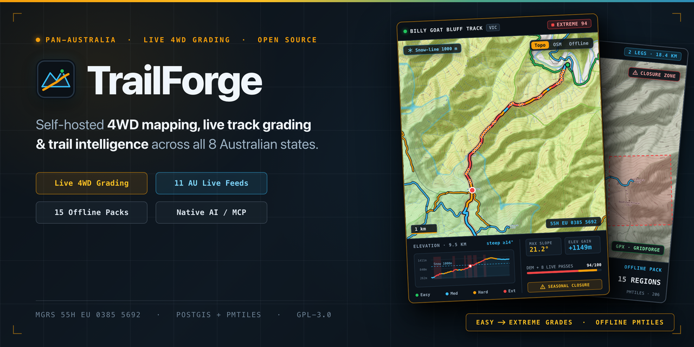
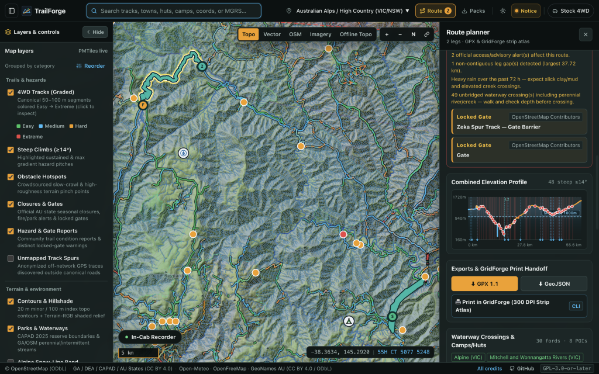
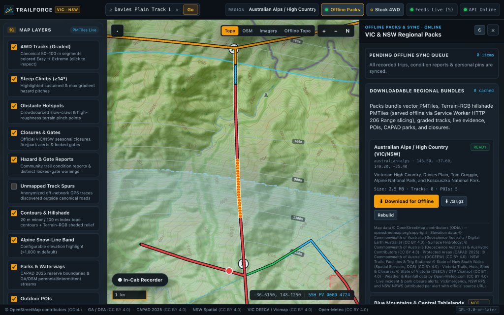

<div align="center">

<a href="docs/images/banner.png"></a>

# TrailForge

**Open-source, self-hostable 4WD & off-road mapping, explainable track grading, route planning, and AI/MCP trail intelligence — built first for all 8 Australian states & territories.**

[](https://mytrailforge.com)
[](https://github.com/jremick/trailforge/actions/workflows/ci.yml)
[](https://github.com/jremick/trailforge/releases/latest)
[](LICENSE)
[](pyproject.toml)
[](Dockerfile)
[](web/package.json)
[](https://github.com/jremick/trailforge/pkgs/container/trailforge-backend)
[](docker-compose.ghcr.yml)
[](https://github.com/jremick/gridforge)

**[Try Live Demo](https://mytrailforge.com)** · [Highlights](#highlights) · [Screenshots](#screenshots) · [Quickstart](#quickstart) · [Planned Roadmap](#planned-roadmap) · [Documentation](#documentation--development) · [Data & Licensing](#data-sources--licensing)

</div>

---

## Try It Live

Explore Pan-Australia 4WD tracks right now at **[mytrailforge.com](https://mytrailforge.com)** — no sign-in required. Browse graded tracks across `VIC`, `NSW`, `ACT`, `TAS`, `QLD`, `WA`, `SA`, and `NT`, inspect elevation profiles and live agency closures, test Quick Rig suitability (`AWD`–`Modified 4WD`), plan multi-track routes, and export GPX/GeoJSON.

---

## Highlights

- **Explainable 2-Stage Track Grading:** Combines a deterministic Day-1 DEM/OSM baseline (`surface`, `tracktype`, slope degrees, waterway crossings, `4wd_only`) with recency-weighted, rig-normalized telemetry and 72-hour rainfall context — exposing every factor, sample count, and obstacle hotspot instead of a black-box score.
- **Interactive Multi-Track Route Planner & Print Handoff:** Chain tracks with automatic leg orientation, combined 4-grade elevation profile, worst-grade & rig suitability rollup, closure/gate warnings, GPX 1.1 / GeoJSON export, and one-click **[GridForge](https://github.com/jremick/gridforge)** 300 DPI waterproof strip atlas CLI handoff.
- **Pan-Australia Open Data & 11 Live Closure Feeds:** Conflates OSM with all 8 Australian state trail agencies into deterministic 50–100 m segments alongside CAPAD 2025 parks, click-to-inspect emergency/park incidents, and community hazard/gate reports with one-click OSM access fixes.
- **Offline-First PWA, Vector Basemaps & 15 Regional Packs:** Streaming `< 300 MB` RAM offline packs (`PMTiles` HTTP `206` byte-range serving), self-hosted Noto Sans glyphs, Pan-AU places/regions/highways & park labels, optional split-stack OpenMapTiles vector basemap (`TRAILFORGE_VECTOR_BASEMAP_URL`), and an in-cab GPS + 50 Hz IMU / 4WD clinometer recorder with one-tap Backtrack.
- **Privacy-by-Design Telemetry & Pluggable Map-Matching:** Enforces mandatory `≥ 250 m` start/end buffer trimming on GPS + IMU uploads, stores zero `user_id`/`trip_id` on public aggregates, matches traces with an in-PostGIS HMM by default, and supports an optional **Valhalla** sidecar ([`deploy/valhalla.md`](deploy/valhalla.md)).
- **Native AI / MCP Server & Interactive Explorer:** Built-in stateless Streamable HTTP MCP server (`18` tools, Pillow PNG trail/elevation visuals, interactive SEP-1865 MCP App) with self-hosted **OAuth 2.1 + PKCE** & Personal Access Tokens for ChatGPT, Claude, Antigravity, Gemini, and Cursor ([`docs/AI_INTEGRATION.md`](docs/AI_INTEGRATION.md)).
- **Lean Self-Hosting & ODbL-Clean Architecture:** Runs in **`~350 MiB` idle RAM** (zero Redis/Kafka, zero PyQGIS) with multi-arch (`amd64`/`arm64`) GHCR images, strict 3-tier OSM ODbL table separation, and a hardened ~$5–$10/mo Railway + Cloudflare Pages/R2/WAF deploy kit.

---

## Screenshots


| **Multi-Track Route Planner & GridForge Handoff** | **Rig Suitability, Closures & Gate Warnings** |
| :---: | :---: |
|  |  |
| **Streaming Offline Regional Packs** | **In-Cab PWA Recorder & Backtrack** |
|  |  |

---

## Quickstart

### Local Build & Offline Demo Corridor (`docker compose`)

```bash
git clone https://github.com/jremick/trailforge.git
cd trailforge
cp .env.example .env
docker compose up -d --build --wait
make seed-corridor
```

Open **<http://localhost:5173>** to explore the seeded VIC/NSW Australian Alps demo corridor (graded tracks, terrain/snow-line, closures, live telemetry, and a downloadable offline pack). Run `./examples/demo-walkthrough.sh` for an automated API/GPX walkthrough ([`examples/README.md`](examples/README.md)), and `make down` to stop.

### Zero-Build Homelab / Production Deploy (Prebuilt GHCR)

```bash
cp .env.example .env   # set strong secrets, CORS_ORIGINS & AUTH_COOKIE_SECURE=true
docker compose -f docker-compose.ghcr.yml up -d
curl -fsS http://127.0.0.1:5173/api/health
```

- **Homelab HTTPS (Tailscale Serve, Caddy v2, Traefik v3), backups & upgrades:** [`deploy/README.md`](deploy/README.md)
- **Hardened public hosting (Railway + Cloudflare Pages/R2/WAF, invite-only + Admin Console):** [`deploy/railway/README.md`](deploy/railway/README.md)

### Baking Real Open-Data Regions (`bake_cli`)

TrailForge streams Geofabrik `.osm.pbf` + state agencies + GA/DEA DEMs in `< 300 MB` RAM across **15 Australian regions** (`7` iconic 4WD regions + `8` statewide packs):

```bash
make bake-alps BAKE_ARGS="--pbf /data/cache/australia-latest.osm.pbf"
# Or bake any region directly (e.g. australian-alps, blue-mountains, vic, nsw, tas, qld, wa, sa, nt):
docker compose exec -T api python -W error::RuntimeWarning -m trailforge.ingestion.bake_cli \
  --region vic --pbf /data/cache/australia-latest.osm.pbf --cache-dir /data/cache --build-tiles --build-pack
```

---

## Planned Roadmap

High-value priorities planned next (kept updated as milestones ship; see [`docs/PLAN.md`](docs/PLAN.md) for the phased regional plan and [`CHANGELOG.md`](CHANGELOG.md) for shipped releases):

- [ ] **Statewide Production Pack Bakes & Bundled Vector Basemaps (Australia):** Automate production PBF/DEM/closure pack bakes across all 8 Australian states & territories (15 regions, synced to Cloudflare R2), bundling self-hosted OpenMapTiles vector basemap `PMTiles` so regional packs render crisply 100% offline with zero third-party tile dependency.
- [ ] **Multi-Week Live Agency Soak & Drift Monitoring:** Long-running soak testing and automated schema-drift checks across all 11 Australian emergency and park closure feeds.
- [ ] **Native Mobile Builds & In-Dash Projection (CarPlay / Android Auto):** Package installable iOS & Android builds from the Capacitor 7 shell ([`mobile/README.md`](mobile/README.md)) and implement native **Apple CarPlay (`CPMapTemplate`)** and **Android Auto (`NavigationTemplate`)** offline map projection, Backtrack guidance, quick hazard/gate pinning, and live clinometer alerts ([`mobile/carplay-android-auto.md`](mobile/carplay-android-auto.md)).
- [ ] **North America Expansion (US & Canada):** Extend the ODbL-separated connector and offline pack model with USFS MVUM, BLM public lands & routes, state/provincial park feeds, USGS 3DEP / Natural Resources Canada DEMs, highway/place gazetteers, and iconic regional packs (Colorado/Utah/Moab, Pacific Northwest, Sierras/Mojave, BC/Alberta Rockies).
- [ ] **New Zealand, Europe & Southern Africa Expansion:** Add New Zealand DOC & LINZ backcountry tracks, huts, and topo contours; European alpine/overland corridors; Southern Africa 4x4 networks; and community-contributed regional connectors and vector basemap packs on the same ODbL-clean schema.

---

## Documentation & Development

| Topic | Guide |
| :--- | :--- |
| **Homelab Self-Hosting & HTTPS** (Tailscale, Caddy v2, Traefik v3, backups) | [`deploy/README.md`](deploy/README.md) |
| **Public Cloud Hosting** (Railway + Cloudflare Pages, R2 `$0`-egress, WAF) | [`deploy/railway/README.md`](deploy/railway/README.md) |
| **AI & MCP Server** (ChatGPT, Claude, Antigravity, Gemini, Cursor, OAuth 2.1) | [`docs/AI_INTEGRATION.md`](docs/AI_INTEGRATION.md) |
| **Mobile Shell & In-Dash Projection** (Capacitor 7, 50 Hz IMU, CarPlay / Android Auto) | [`mobile/README.md`](mobile/README.md) · [`mobile/carplay-android-auto.md`](mobile/carplay-android-auto.md) |
| **Optional Valhalla Sidecar** (`/trace_attributes` with HMM fallback) | [`deploy/valhalla.md`](deploy/valhalla.md) |
| **Demo Walkthrough, Sample GPX & GridForge Print Handoff** | [`examples/README.md`](examples/README.md) |
| **Spatial Schema, GIS Connectors & Engineering Invariants** | [`docs/SPEC_GIS_SCHEMA.md`](docs/SPEC_GIS_SCHEMA.md) · [`AGENTS.md`](AGENTS.md) |
| **Contributing, Architecture Rules & Release History** | [`CONTRIBUTING.md`](CONTRIBUTING.md) · [`CHANGELOG.md`](CHANGELOG.md) |

**Stack:** Python 3.12 + FastAPI · PostgreSQL 16 + PostGIS 3.4 · GDAL / `osmium` / Tippecanoe / `rio-rgbify` / `PMTiles` · TypeScript + Vite + MapLibre GL JS 6 PWA (`~350 MiB` idle RAM, `< 300 MB` streaming bake/pack RAM, `0.18–0.63 ms` GIST lookups at 11k+ segments).

```bash
make lint               # ruff lint & formatting checks
make test-unit          # offline host unit & config parity tests (no DB required)
make test-integration   # isolated Docker PostGIS integration suite (trailforge_test)
make web-check          # TypeScript check, Vite PWA + MCP App builds, Vitest suite
```

---

## Closure feed sync

QLD defaults to Queensland Fire Department bushfire warnings. NT defaults to Road Report NT.
The `TRAILFORGE_QLD_DES_ALERTS_URL` and `TRAILFORGE_NT_SECURENT_URL` overrides select one
upstream dataset per feed. Each configured endpoint has its own snapshot and sync history.
Changing the endpoint retains alerts from the previous one. A successful poll clears missing
records from its own snapshot. The schema upgrade retains historical QLD and NT alerts whose
original dataset cannot be determined and shows them as stale.

Offline fixture sync reads the HTTP feeds listed in the file and refreshes OSM access from the
local track database when selected. An explicit empty feed clears its fixture records. Live alerts
and live feed health use independent snapshots. The committed sample fixture covers three HTTP
feeds. Use offline fixtures with a test database.

The feed reader limits both transferred and decoded responses to 10 MiB. VIC seasonal closure
pages are collected within the same decoded budget before reconciliation. Oversized or reported
incomplete snapshots leave the last successful snapshot intact. Alerts covering more than
5,000 km² are matched by polygon intersection when loading track and route advice to avoid
creating links across an entire region.

## Data Sources & Licensing

| Source | Coverage | License & Attribution |
| :--- | :--- | :--- |
| **TrailForge Source Code** | Backend API, spatial pipelines, worker, web PWA & mobile bridge | **GNU GPL v3.0 or later** ([`LICENSE`](LICENSE)) |
| **OpenStreetMap** | Roads, 4WD tracks, gates, access tags, POIs | **ODbL** — © OpenStreetMap contributors (`openstreetmap.org/copyright`) |
| **Geoscience Australia / DEA & DCCEEW** | 5 m LiDAR & SRTM 1s DEM (`AHD`), Surface Hydrology, Topo250K, CAPAD 2025 Protected Areas | **CC BY 4.0** — © Commonwealth of Australia (GA / DEA / DCCEEW) |
| **AU State & Territory Mapping Agencies** | VIC (DEECA / DTP Vicmap), NSW (Spatial Services, DCS), ACT (ACTmapi / EPSDD), QLD (QSpatial / DESI / DNRM), WA (DBCA & Landgate SLIP — `CC BY-NC` excluded), SA (DEW / DHUD), NT (NTLIS / DEPWS) | **CC BY 4.0** — © respective State & Territory Governments |
| **Tasmania Mapping** | TAS 4WD tracks, fire trails, alpine huts & survey control | **CC BY 3.0 AU** — © State of Tasmania (the LIST, NRE Tas) |
| **AU Emergency & Park Feeds** | VicEmergency, MapShareVic, NSW RFS/NPWS, ACT ESA, TasALERT/PWS, QLD QFD/QPWS, Emergency WA, SA CFS/NPWS, NT Road Report/SecureNT | Official state agency public feeds (attributed per alert with source links) |
| **Open-Meteo** | 72-hour precipitation context for wet/dry grading | **CC BY 4.0** (non-commercial API; AGPLv3 self-hostable backend) |

TrailForge enforces strict **3-tier OSM ODbL separation** (isolating OpenStreetMap base tables from independent crowdsourced telemetry, live grades, closures, condition reports, and saved routes) and preserves all required attributions across the UI, API, MCP outputs, exports, and offline pack manifests.
