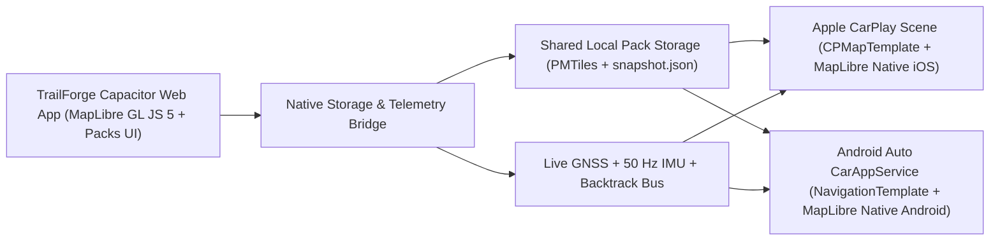

# TrailForge In-Dash Projection Spec — Apple CarPlay & Android Auto

This document specifies the native automotive head-unit projection architecture for **Apple CarPlay** (`CPMapTemplate`) and **Android Auto** (`NavigationTemplate`) consuming TrailForge's locally cached Pan-Australia offline PMTiles packs, Track Inspector summaries, agency closure alerts, and Backtrack telemetry.

---

## 1. Architectural Overview

CarPlay and Android Auto do **not** render arbitrary HTML/WebView UIs for driver safety reasons. Instead, the native iOS/Android shell pairs Capacitor's web experience (used when stopped / trip planning) with a lightweight native **MapLibre Native** canvas and strict template UI that reads the exact same offline regional packs and live recorder state on-device.

### Shared Local Storage Contract
- **iOS:** Store extracted regional packs (`vector.pmtiles`, `terrain.pmtiles`, `manifest.json`, `snapshot.json`) inside an App Group container (`group.org.trailforge.app/packs/<region_id>/`) so both the main Capacitor app and the CarPlay `CPTemplateApplicationSceneDelegate` read identical verified files with zero duplication.
- **Android:** Store packs under `Context.filesDir/trailforge-packs/<region_id>/` so both the Capacitor WebView plugin and `TrailForgeCarAppService` access them directly via local random-access file reads (zero HTTP overhead).
- **Zero-Network Guarantee:** Every map tile, difficulty grade color, CAPAD boundary, POI symbol, and downloaded closure snapshot renders 100% offline in zero-signal outback corridors.

---

## 2. Apple CarPlay Specification (`CPMapTemplate`)

### Entitlements & Scene Setup
- Request the **`com.apple.developer.carplay-navigation`** entitlement in Apple Developer Portal.
- Register `UIApplicationSceneManifest` -> `CPTemplateApplicationSceneSessionRoleApplication` pointing to `TrailForgeCarPlaySceneDelegate`.
- Root template: `CPMapTemplate` hosting a `MLNMapView` (MapLibre Native iOS) styled with TrailForge's dark outdoors palette (`#0E151B` base, Easy `#22C55E` / Medium `#38BDF8` / Hard `#F59E0B` / Extreme `#EF4444` track grading, steep `>= 14°` highlights, active closures).

### Template Hierarchy & Driver-Safe Controls
1. **Primary Canvas (`CPMapTemplate`):**
   - **Leading Navigation Bar Buttons:**
     - `Backtrack` (`CPBarButton`) — toggles reversed breadcrumb return guidance (`CPNavigationSession` with live return distance and next-turn compass bearing).
     - `Mark` (`CPBarButton`) — pushes a concise 1-tap `CPActionSheetTemplate` / `CPListTemplate` for dropping **Camp**, **Hazard**, or **Locked Gate** pins at current GPS coordinates (queued into TrailForge's offline sync queue).
   - **Trailing Navigation Bar Buttons:**
     - `Track` (`CPBarButton`) — opens a read-only `CPInformationTemplate` (Track Inspector summary) for the nearest canonical segment: Name, Effective Grade, Max Slope, 72 h Rainfall Risk, Active Closure Status, and Rig Suitability rating.
   - **Map Buttons (`mapButtons`):** Pan mode toggle, Zoom In (`+`), Zoom Out (`-`), Recenter / North-Up vs Heading-Up.
2. **Proactive Safety Alerts (`CPNavigationAlert`):**
   - **Agency Closure / Locked Gate Ahead:** Triggers high-contrast banner when approaching a segment flagged `closed`, `seasonal`, or `locked_gate` within 500 m.
   - **4WD Clinometer Alert:** Non-blocking warning banner when live IMU exceeds **Caution (`>= 15°`)** or **Hazard (`>= 25°`)** pitch/roll thresholds.
   - **Obstacle Hotspot Ahead:** Alerts driver 250 m before crowdsourced slow-crawl / high-roughness pinch points.
3. **Distraction Compliance:**
   - No free-text keyboard entry while moving; regional pack downloads and account login remain phone-only in the Capacitor UI.
   - Template stack depth strictly `<= 3` (`CPMapTemplate` -> `CPListTemplate` / `CPInformationTemplate`).

---

## 3. Android Auto Specification (`NavigationTemplate`)

### Manifest & `CarAppService` Setup
- Declare `androidx.car.app.minCarApiLevel = 6` and category `androidx.car.app.category.NAVIGATION` in `AndroidManifest.xml`.
- Implement `TrailForgeCarAppService : CarAppService()` returning a `Session` whose root `Screen` builds a `NavigationTemplate`.
- Register a `SurfaceCallback` via `AppManager.setSurfaceCallback(...)` to render the **MapLibre Native Android** map directly onto the head-unit `Surface` using the local regional `.pmtiles` files.

### Template Hierarchy & Controls
1. **Root Screen (`NavigationTemplate`):**
   - **`ActionStrip` (Primary Bar):**
     - **Backtrack Toggle:** Activates reversed breadcrumb return route, updating `RoutingInfo` with next waypoint compass bearing (`N/NE/E/...`), return distance, and `TravelEstimate`.
     - **Quick Pin:** Opens a 4-item `ListTemplate` (**Camp**, **Fallen Tree / Hazard**, **Bog Hole / Washout**, **Locked Gate**) that saves immediately to the offline sync queue.
     - **Track Info:** Opens a concise `PaneTemplate` showing the active/nearest track's Effective Grade, Baseline vs Live Confidence, Rig Suitability, 72 h Rain Risk, and Closure Status.
   - **`MapActionStrip` (Map Controls):** Pan (`Action.PAN`), Zoom In, Zoom Out, Recenter / Heading-Up toggle.
   - **Live Telemetry Card (`NavigationInfo`):**
     - Displays current elevation (m AHD), speed (km/h), live **Pitch° / Roll°** clinometer readout (highlighting amber `>= 15°` / red `>= 25°`), and active recording indicator (`REC`).
2. **Safety Alerts (`Alert`):**
   - Uses `NavigationTemplate.Builder.setPendingAlert(...)` for approaching state agency closures, locked-gate community warnings, and severe clinometer angles.

---

## 4. Telemetry, Backtrack & Privacy Invariants

- **Live Sync Bridge:** Head-unit actions (Backtrack toggle, Quick Pin drop, Stop Recording) emit structured events to the shared native telemetry repository, keeping the phone UI and dash display in exact sync.
- **Privacy Guarantee:** Trips started or monitored via CarPlay / Android Auto still route through TrailForge's `POST /api/trips/mobile-sync` pipeline with mandatory `>= 250 m` start/end GPS + IMU buffer trimming and opt-in `private` vs `community_anonymous` visibility.
- **Attribution Preservation:** OpenStreetMap (ODbL) and Australian open-data agency attributions remain visible in the map overlay footer and Track Inspector / About screens.
